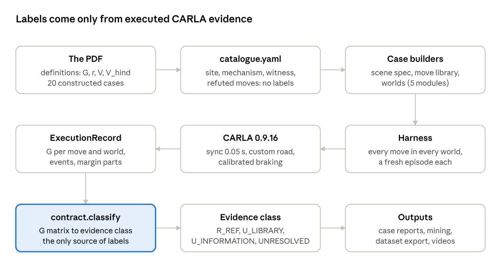

# CARLA Recoverability Cases: Setup, Decisions and Results

As of 2026-10-20 · Frederick Wang (Approach 1)

> Live version: [Claude Doc](https://claude.ai/artifact/FqWMCYVENDUFkjkbAVpykJ) (anyone with the link can open it).
> This file is a snapshot of it. The generated numbers report is [`carla_results.md`](carla_results.md).

All 20 recoverability cases from the PDF were built and labelled on CARLA 0.9.16. Every label comes from executed evidence, never set by hand. 19 cases show their intended mechanism; RC04 has no positive example on CARLA. Boundary mining ran on three case families (corridor, RC03, RC07) with seven algorithms, and information-gap mining on one. Braking-to-stop boundaries are specific to the 0.05 s simulation step (see Time-step sensitivity).

## Contents

1. [From the PDF to code](#from-the-pdf-to-code)
2. [Pipeline](#pipeline)
3. [CARLA setup](#carla-setup)
4. [Results by case](#results-by-case)
5. [Where we differ from the PDF](#where-we-differ-from-the-pdf)
6. [Boundary and info-gap mining](#boundary-and-info-gap-mining)
7. [G sensitivity on CARLA](#g-sensitivity-on-carla)
8. [Time-step sensitivity](#time-step-sensitivity)
9. [Decisions](#decisions)
10. [Problems and fixes](#problems-and-fixes)
11. [Videos](#videos)
12. [Not done and open issues](#not-done-and-open-issues)
13. [Sources](#sources)

## From the PDF to code

A scene is recoverable when some move in a stated library keeps a positive safety margin in every world the scene allows. The PDF's definitions are implemented exactly in `mining/contract.py` and `mining/margin.py`.

- **Margin G** for one move in one world: the minimum over the horizon of each normalised margin m_i / q_i (clearance to every actor, road edges, dynamic limits), with a terminal test at the end (protected stop or settled lane-follow). A collision or a failed terminal test gives G = −inf.
- **Robust value** r_π = min over worlds of G; **V** = max over moves of r_π. **V_hind** = min over worlds of the best move in that world; **info_gap** = V_hind − V.
- **Evidence class** from the matrix of G values (`contract.classify`): `R_REF` (a witness move passes every world), `U_LIBRARY` (every move in the library fails somewhere), `U_INFORMATION` (every world is solvable in hindsight, but no single move solves all), `UNRESOLVED`, `INVALID_RUN`.

The 20 cases in the PDF were transcribed to `mining/cases/catalogue.yaml`: site, mechanism, intended evidence, witness move, refuted moves and pilot numbers. Each case group then got a builder module in `mining/cases/` (`corridor`, `two_lane`, `compositional`, `occlusion`, `negatives`). Each builder makes the scene spec, the move library and the worlds; the harness runs every move in every world and writes one ExecutionRecord. **Labels are never written by hand:** the catalogue states an intention, and the record's G matrix decides the class.

Defaults used everywhere (`margin.DEFAULT_V2`): reserve 1.0 m, q_clear 5.0 m, q_road 1.0, q_dyn 1.0, eps 0.0, horizon 8 s, hold 4 s, post-manoeuvre 4 s.

## Pipeline

The catalogue only states what each case intends; the label is decided once, from the executed G matrix, and everything downstream (reports, mining, the dataset, videos) reads that label rather than setting its own.

## CARLA setup

Every case runs on one CARLA 0.9.16 server on a laptop with a 6 GB RTX 3060, in synchronous mode at 0.05 s per tick, with no Traffic Manager. How to install and start it: [`CARLA_SETUP.md`](CARLA_SETUP.md).

| Part | What we use |
| --- | --- |
| Site | Custom OpenDRIVE road `mining/sim/assets/straight_2lane.xodr`: flat and straight, 1.5 km, two same-direction 3.5 m lanes. Generated once per server session (repeated `load_world` crashed the server). |
| Physics step | 0.05 s, substepping 0.01 s × 10 |
| Ego | Tesla Model 3; measured half-length 2.3959 m |
| Obstacles | Static cars held by hand brake (RC16's post is frozen); moving actors run project-owned finite-state controllers keyed to sim time or observed events |
| Start | A 2 s warm-up approach at the declared speed; static blockers are then re-placed from the measured ego bumper, so the declared gap is exact at t0 |
| Braking | Physics profile `pp_381b4c6e55` (tyre friction fixed at 5.0, brake torque calibrated to a 6.19 m/s² target). Measured from braking traces: b_cal = 6.211 m/s², effective delay tau_eff = configured delay + 0.05 s |
| Delay | Actuation delay 0.25 s (5 ticks) unless the case varies it |
| Declared limits | Sideways a_lat_max = 8 m/s² in the two-lane cases; RC18 adds a combined brake-plus-steer limit a_comb_max = 8 m/s², applied only while the smoothing window is above 5 m/s |
| Observation | The ego sees a 20 Hz feed of actor states. Partial-observation worlds withhold an actor until its reveal time (or after its forget time); nothing physical hides it |

**Known plant caveats.** Moving actors start 3.2–5.3% below their declared speed, from warm-up drag; measured speeds are reported. CARLA is not deterministic: repeats of one scene in one server session differ by up to 0.028 in G, and the same scene across server sessions has shifted by up to 0.196, enough to flip one move from pass to fail. Braking to a stop also depends on the step size: the 0.05 s step ends braking with an artificial snap to rest (Time-step sensitivity).

## Results by case

19 of 20 cases show the PDF's intended contrast on CARLA; RC04 does not. G is the margin of the named move in the headline scene (positive = passes). Speeds are in m/s, distances in m.

| Case | Headline scene on CARLA | Move that works (G) | Move that fails (G) | CARLA label |
| --- | --- | --- | --- | --- |
| RC01 Braking with a protected stop | gap 16, v 12, delay 0.25 s | brake_hold (+0.018) | — | R_REF |
| RC02 Too late to stop | gap 15.75, v 12, full library | — | brake_hold (−0.032), bypass_left (collision) | U_LIBRARY |
| RC03 Braking fails, swerve works | v 18, gap 30, lane change 2 s | bypass_left (+0.008) | brake_hold (collision) | R_REF; U_LIBRARY with the escape lane closed |
| RC04 Brake first, then change lanes | 92 scenes searched | none found | — | no positive example |
| RC05 Abort an unsafe lane change | gap 80, rear gap 35, rear v 20 | abort_and_stabilize (+0.105) | commit_lane_change (collision) | R_REF |
| RC06 Yield, then use a later gap | gap 60, passer gap 20, passer v 16 | wait_observe_enter (+0.017) | immediate_entry (collision) | R_REF |
| RC07 Keep avoiding, don't hand back early | gap 34, rear gap 100, rear v 18 | bypass_then_return (+0.119) | bypass_then_stop (collision) | R_REF |
| RC08 Protected wait, route not finished | closed lane, gap 45, v 14 | brake_hold (+0.667), route goal not reached | — | R_REF, route_goal_completed = false |
| RC09 Front/rear conflict, no escape | v 14, front gap 23, rear gap 25 | — | all 25 moves (e.g. full brake, swerve, keep speed: collision) | U_LIBRARY for that 25-move class |
| RC10 Early evidence allows escape | v 14, hidden car at 19, revealed at 0.1 s | shared_slowdown_then_branch (+0.049) | — | R_REF |
| RC11 Late evidence | same, revealed at 0.6 s | — | same move (collision) | U_INFORMATION |
| RC12 Late handover | gap 40, v 12 | brake at once (+0.668) | keep speed 2.25 s, then brake (collision) | R_REF → fails with prefix |
| RC13 Over-cautious predictor | v 14, hidden at 20, revealed at 0.2 s | shared_slowdown_then_branch (+0.050), rejected by the predictor | — | R_REF; robust in 2 of 4 scenes at the 0.028 spread |
| RC14 Memory resolves a hidden car | v 14, seen then hidden at 0.6 s | memory policy (+0.081) | current-frame-only policy (collision) | R_REF |
| RC15 Yielding must be observed | gap 60, adjacent car gap 35, v 16 | observe_yield_else_fallback (+0.105) | always_merge (collision, car does not yield) | R_REF |
| RC16 Centre line clears, body does not | v 12, post 1.6 m off centre | nudge_left (+0.045) | lane_follow (−0.155) | R_REF (brake_hold also passes) |
| RC17 Response delay | gap 18, v 12 | delay 0.40 s (+0.068) | delay 0.45 s (−0.061) | edge at 0.425 s vs 0.401 s analytic |
| RC18 Command beyond grip | v 22, gap 42 | bypass_left (+0.068) | brake+steer command (−0.339 once a_comb is checked) | R_REF |
| RC19 Irrelevant nuisance | v 8, with and without a far car | lane_follow (+0.668 both) | — | R_REF; \|dV\| = 0.000 |
| RC20 Library completeness | RC03 scene, v 18, gap 30 | full library: bypass_left (+0.008) | braking-only library (collision) | U_LIBRARY → R_REF |

On the foundation cases the CARLA stopping boundary sits 0.32 m below the analytic d_required = 16.19 m; 0.25 m of that is the measured 1% speed shortfall at the brake onset. Per-case details and every scan row are in the `mining/results/carla/*.md` files.

**How firm these margins are.** Repeats in one server session move G by up to 0.028; one re-run on a fresh server moved an RC03 margin by 0.196. Only RC08 (+0.667), RC12 (+0.668) and RC19 (+0.668) clear 0.196. Every other passing headline margin (+0.008 to +0.119) could flip in a new server session, so those labels hold for the session that produced them; RC03 and RC20 at +0.008 are the most fragile.

## Where we differ from the PDF

The definitions and the labelling rule follow the PDF exactly; seven case constructions differ, each for a reason we could measure.

| Case | PDF | On CARLA | Why |
| --- | --- | --- | --- |
| RC03 | speeds 8–14 m/s | shown at 18 and 22 m/s | Under the 8 m/s² sideways limit, no swerve window exists at 8–14 m/s: every admissible lane change needs more gap than braking does |
| RC04 | staged brake then lane change works where single moves fail | no example | 92 scenes with time-defined lane changes, then 22 with path-length lane changes (below); none showed the contrast. Reported, not forced |
| RC10, RC11, RC13, RC14 | junction or occluding-van site | same straight two-lane road; the car is withheld from the ego's feed until the reveal time | Keeps one site for all cases. A physical blocker would add an obstacle to the margin and change the labels |
| RC02 | a model result: no move can avoid the crash | unrecoverable for the stated move library only (U_LIBRARY) | A finite CARLA library cannot prove that no controller could recover |
| RC09 | unrecoverable | U_LIBRARY for the stated 25-move class, in one rear-vehicle world | Same reason; the left lane is blocked by a queue of parked cars |
| RC13 | an over-cautious predictor rejects the working move | a simple envelope predictor in `cases/negatives.py`, outside the labelling pipeline | It illustrates the false rejection; it never produces a label |
| All two-lane cases | physical tyre limits | declared limits a_lat_max = 8 m/s² (and a_comb_max = 8 m/s² in RC18) | The calibrated tyre friction of 5.0 is not physical, so an unlimited lane change could use impossible grip |

### RC04: why no example was found

- **Time-defined lane changes (the first 92 scenes):** a perfectly tracked lane change of fixed duration has the same sideways acceleration at every speed. Braking first then shortens the distance the change needs only below about 10–12 m/s, while a swerve beats braking only above about 17 m/s, so the windows do not overlap. The steering controller adds some speed dependence: enough on the mock plant (a contrast at 18 m/s, lane change 1.6 s), not enough on CARLA.
- **Path-length lane changes (added, `cases/compositional.rc04_path_library`):** a change over a fixed distance has sideways acceleration growing with v², which is the PDF's mechanism. On the mock plant this gives the contrast in 22 scenes (30 m change at 22 m/s; 40 m change at 25–30 m/s).
- **On CARLA (22 scenes, `mining/results/carla/rc04_path.md`):** the immediate change fails as predicted (12–17 m/s² against the 8 m/s² limit), but braking first then changing passes only where braking alone already passes; the closest scene (28 m/s, 60 m gap) has both at −0.013. CARLA's braking is stronger than the mock's near standstill (see the time-step section), which shifts the braking boundary onto the window. 30 m/s was not tried.

## Boundary and info-gap mining

Mining searches inside one case family for where scenes switch from recoverable to unrecoverable; on CARLA the boundary-seeking straddle search puts 86–90% of its scenes near the boundary, against 37–52% for random Sobol sampling. Search sees only a clipped margin; every label still comes from the full record. Two seeds per algorithm, 100 scenes each (40 for the falsifiers cem and bo_lcb).

| Family | Algorithm | Unrecoverable scenes (mean per seed) | Near boundary, \|V\| < 0.3 | Matched pairs |
| --- | --- | --- | --- | --- |
| Corridor (RC01/02), gap × speed | sobol | 48.5 / 100 | 51.5 | — |
| | straddle | 71.5 / 100 | 85.5 | — |
| | bisect | 55.5 / 100 | 75.0 | 7.5 per seed (15 total) |
| | cem | 32.5 / 40 | 33.0 | — |
| | bo_lcb | 32.5 / 40 | 33.5 | — |
| RC03 swerve family, gap × speed | sobol | 29.5 / 100 | 36.5 | — |
| | straddle | 67.5 / 100 | 89.5 | — |
| | bisect | 39.0 / 100 | 72.0 | 11 per seed (22 total) |
| | cem | 30.5 / 40 | 32.5 | — |
| | bo_lcb | 33.5 / 40 | 34.0 | — |
| RC07 hand-back family, gap × rear gap × rear speed × speed | sobol | 6.5 / 100 | n/a (all margins < 0.3) | — |
| | straddle | 29.5 / 100 | n/a | — |
| | bisect | 42.5 / 100 | n/a | 8 per seed (14 distinct) |
| | cem | 11.5 / 40 | n/a | — |
| | bo_lcb | 30.5 / 40 | n/a | — |

Quality-diversity search (qd_fail, qd_boundary; 40 scenes per seed) spreads its scenes for coverage rather than chasing the boundary:

| Family | qd_fail unrecoverable | qd_boundary unrecoverable | qd near boundary (of 40) |
| --- | --- | --- | --- |
| Corridor | 23.0 / 40 | 21.5 / 40 | 23.5 and 22.5 (cem and bo_lcb: 33) |
| RC03 | 12.0 / 40 | 11.5 / 40 | 14.0 and 13.5 |
| RC07 | 3.5 / 40 | 4.0 / 40 | n/a |

- **Matched pairs** are two scenes that differ in one setting, one recoverable and one not; both were re-run and re-labelled from the full record. 51 pairs in total (15 corridor, 22 RC03, 14 RC07).
- **RC07:** unrecoverable scenes are rare (random sampling finds 6.5 per 100); the boundary-seeking methods find 4–6 times as many. Every RC07 margin is small (the best move reaches about +0.12), so the near-boundary count is not informative there.
- **Agreement with the formula:** in the corridor family the CARLA label matches the sign of the analytic margin for 86–99% of scenes; the bisect flip sits 0.97 m on the safe side of the analytic boundary on average.
- **Info-gap mining (RC10/RC11 family):** cem and straddle searched (D, v, t_reveal) for scenes unrecoverable only for lack of information (V_hind ≥ 0 > V). 6 of 36 scenes were found; the best has gap 0.188 (D 26.8 m, v 17.1 m/s, reveal 0.7 s). All 6 sit below the analytic common-stop distance and after the analytic reveal threshold, as the theory requires.

## G sensitivity on CARLA

The normalisation constants cannot change a label, while the 1 m clearance reserve and the eps threshold move 5–10% of the stored CARLA records across the boundary. All 2,230 usable records were re-scored from their stored margin parts, with no new runs; at the default constants every record reproduces its stored G and label exactly.

| Constant | Change | Records changing class (of 2,230) |
| --- | --- | --- |
| reserve_m (1.0 m) | ×0.5 | 193 |
| reserve_m | ×1.5 | 227 |
| q_clear, q_road, q_dyn | ×0.5 or ×1.5 | 0 |
| eps (0) | −0.05 | 116 |
| eps | +0.05 | 127 |

These rates overstate the sensitivity of a typical scene: mining and the case sweeps put most records near the boundary on purpose. 24 RC03 records were left out because two library moves share a name. Horizon, hold time, post-manoeuvre time and stop speed change the rollout itself, so they need new CARLA runs and were not tested.

**Dataset.** The CARLA E1 export (`mining/export.py records --backend carla`) now holds 2,318 labelled scenes: corridor 782, RC03 750, RC07 750 and info-gap 36 (1,185 R_REF, 1,127 U_LIBRARY, 6 U_INFORMATION), 0 invalid, 2,042 split groups. This is in addition to the 20 hand-built case scenes. It is git-ignored; rebuild it from the mining records.

## Time-step sensitivity

Margins that do not end in a stop are stable to the step size, but every braking-to-stop result depends on the 0.05 s step. The headline scenes were re-run at 0.025 s in the same server session (`mining/results/carla/dt_check.md`; RC18 left out, because its brake-steer limit smooths over a fixed number of ticks).

| | Result |
| --- | --- |
| Margins compared | 98 policy-world margins in 23 scenes |
| Finite shifts | median 0.003, largest 0.028 (the within-session repeat spread) |
| Sign changes | 6, all stop-and-hold moves with small margins at 0.05 s (RC01 brake_hold, RC17 at 0.40 s, RC05 abort_if_closing, RC06 wait moves, RC15 fallback), all to −inf |
| Label changes | 2: RC01 at gap 16 and RC17 at delay 0.40 s become U_LIBRARY |

**Cause.** At 0.05 s the last 6 m/s of braking ends in a 23–33 m/s² snap to rest (it is visible in the calibration bands); at 0.025 s it is absent and the car decelerates at about 4 m/s² to the end. In RC01 the ego then reaches the blocker at 4.8 m/s instead of stopping 1.08 m short. The snap is a numerical artefact of the coarser step, and the calibrated b_cal = 6.211 m/s² includes it. **So braking boundaries (RC01/RC02, RC17's delay edge, the corridor mining boundary) hold for the 0.05 s step and, in the one scene measured (RC01, gap 16 m), are about 3 m optimistic against a finer step (the ego still moves at 4.8 m/s at the blocker, 3 m of braking at 4 m/s²).** Lane-change, library, observation and nuisance results are unaffected. A re-run at a finer step would mean re-calibrating the brakes and re-running every braking case.

## Decisions

Each decision below was taken where the PDF or the spec left a gap; the last column says what it costs if it turns out wrong.

| Decision | Why | Cost if wrong |
| --- | --- | --- |
| One custom straight two-lane road for every case | Built-in towns lack a long enough straight (Town04: about 230 m); repeated map loads crashed the server | Layouts differ from the PDF's junction and van figures |
| Declared limits a_lat_max = 8 m/s² (two-lane cases) and a_comb_max = 8 m/s² (RC18) | CARLA's calibrated tyre friction is not physical | Limits are declared, not measured |
| Combined limit only where the whole smoothing window is above 5 m/s | CARLA wheels lock and spike near standstill | Could hide a real violation at low speed |
| Braking fixed at the calibrated 6.19 m/s² target in mining | One physics profile per run | No braking-strength axis on CARLA |
| RC03 shown at 18 and 22 m/s, mined over wider ranges (speed to 24 m/s, gap to 60 m) | No swerve window at 8–14 m/s | The 18 m/s witness is fragile (G = +0.008); mock and CARLA tables are not comparable |
| No forced witnesses | A label must come from evidence | RC04 has no positive example |
| Moving actors pinned to speed during warm-up; RC07 re-run afterwards | Actors had started about 15% slow | A 3–5% shortfall remains, disclosed |
| Hidden cars withheld from the feed, not physically blocked | Keeps one site; a blocker would enter the margin | Weaker visual match to the PDF |
| RC09 left lane blocked; "unrecoverable" claimed for the 25-move class only | A finite library cannot prove impossibility | The scene is constructed, not a general result |
| A result is borderline if any repeat comes within 0.0167 of the boundary | Measured within-session spread at the time | Superseded by the 0.196 cross-session shift |
| Dataset split groups = family plus every non-distance setting, merged across matched pairs | Keeps counterfactual neighbours in one split | Fewer, larger groups |
| Library version = checksum of the library definition | Ties every record to the exact moves run | The version tag changes whenever a move changes |
| Ego half-length taken from CARLA (2.3959 m) and RC03/RC20 re-run | The hard-coded 2.3 m was 0.096 m short | Corridor and RC03 mining still used 2.3 m (no class changed in the re-run) |
| One server only; the two-server determinism check not run | Two servers do not fit in 6 GB of GPU memory | Differences between server processes could go unseen |

## Problems and fixes

No problem below changed a published case label after its fix, except where a re-run is noted. Newest first.

| Stage | Problem | Fix |
| --- | --- | --- |
| Time-step check | Stop-and-hold moves that pass at 0.05 s fail at 0.025 s: the 0.05 s step ends braking with an artificial snap to rest | Documented; braking boundaries stated as specific to the 0.05 s step (re-calibration and re-run not done) |
| RC04 | 92 scenes with time-defined lane changes gave no example | Analysed why; added path-length lane changes (still no CARLA example in 22 scenes) |
| Videos | A camera image left waiting after a tick froze the server's game thread whenever the client sent any other request first | The recorder takes both camera images straight after every tick |
| Videos | The untextured road washed out to white; after a crash, CARLA physics threw cars off the road | Composited colour frames; the clip freezes at first contact (the run ends there anyway) |
| Report | "Max repeat spread 0.028" covered one server session only; a fresh session shifted one RC03 margin by 0.196 | Both figures are now stated; headline margins below 0.196 are flagged |
| Final review | Ego half-length hard-coded at 2.3 m; CARLA's Tesla measures 2.3959 m | Measured value used; RC03 and RC20 re-run, 0 class changes |
| Export | Matched pairs split across train/test groups; half-pairs written | Union-find merge of split groups; pairs written whole |
| RC18 | The brake-steer limit picked up the wheel-lock spike near standstill | Full-window 5 m/s mask, disclosed as artefact-sensitive |
| RC07 | Moving actors began about 15% below their set speed (clutch drag in warm-up) | Speed pinned during warm-up; RC07 re-run, its scene moved to rear gap 100 m |
| Mining | "Repeats are bit-identical" was false | Borderline rule built on the measured repeat spread |
| Throughout | The server crashed or hung several times (one crash in Task 9, hangs while building the video camera) | Restarted with the same command; the selftest passed each time |
| Bring-up | Changing a vehicle's physics resets its dynamics | Wheel friction and brake torque set right after spawn, before the warm-up |

## Videos

36 clips of about 10 s each show the headline scene of every case, re-run live on CARLA; each clip's outcome matches the stored result in sign (36 of 36). They are a visual aid only and never feed a label.

- **Format:** 1 s title card, the 8 s run in real time, 1 s result card with the margin. Chase camera behind and above the ego, 1280 × 720, 20 fps.
- **Colours:** blue = ego, red = parked obstacle, orange = moving car. The road and grass are painted in afterwards, because the generated map has no textures.
- **Hidden cars (RC10, RC11, RC13, RC14):** a car the ego has not been told about yet is drawn as a faint ghost in an amber box marked "not visible to ego"; a banner marks the reveal time.
- **Contact:** the run ends at first contact, so the clip freezes on that frame with a red CONTACT banner rather than showing CARLA's crash physics.

Clips are in `mining/results/carla/videos/` (git-ignored; the index with the sign check is [`videos/index.md`](../mining/results/carla/videos/index.md)); rebuild with `scripts/carla_videos.py --force`, or `--only RC03,RC05` for a subset.

## Not done and open issues

RC07 mining, qd mining, G sensitivity and the time-step check are done; these remain open.

- [ ] **Braking at a finer time step:** re-calibrate the brakes at 0.025 s and re-run the braking cases, if braking boundaries must not depend on the step (about a full day of CARLA time).
- [ ] **RC04 at 30 m/s and above, or with other lane-change lengths:** the last untried part of the path-length window.
- [ ] **Determinism across two servers:** only one server fits in 6 GB of GPU memory.
- [ ] **Cosmos appearance variants:** scheduled for late Oct to early Nov; needs more GPU than this laptop has.
- [ ] **G sensitivity for timing settings** (horizon, hold time, stop speed): needs new CARLA runs.
- [ ] **Corridor and RC03 mining at the measured ego half-length:** mining used 2.3 m; the case re-runs at 2.3959 m changed no class.
- [ ] **A long-highway site (Town06):** would give a real-looking road and match more of the PDF's layouts, but every case would need re-placing and re-running. Town06 ships in CARLA's AdditionalMaps package.

## Sources

All on branch [`carla-physical-scenarios`](https://github.com/fredwang1012/recoverability-aware-world-models/tree/carla-physical-scenarios).

| What | Where |
| --- | --- |
| The PDF | [`docs/spec/Recoverability_Definitions_and_CARLA_Cases.pdf`](spec/Recoverability_Definitions_and_CARLA_Cases.pdf) |
| Case catalogue from the PDF | `mining/cases/catalogue.yaml` |
| Definitions in code | `mining/contract.py`, `mining/margin.py` |
| Generated results report | [`docs/carla_results.md`](carla_results.md) |
| Per-group results | `mining/results/carla/{foundation,core,compositional,occlusion,negatives}.md` |
| Mining results | `mining/results/carla/mining/{corridor,rc03,infogap}/` |
| G sensitivity | `mining/results/carla/g_sensitivity.md` |
| Video index | `mining/results/carla/videos/index.md` |

To re-run anything, see [`CARLA_SETUP.md`](CARLA_SETUP.md) and [`../scripts/README.md`](../scripts/README.md).
