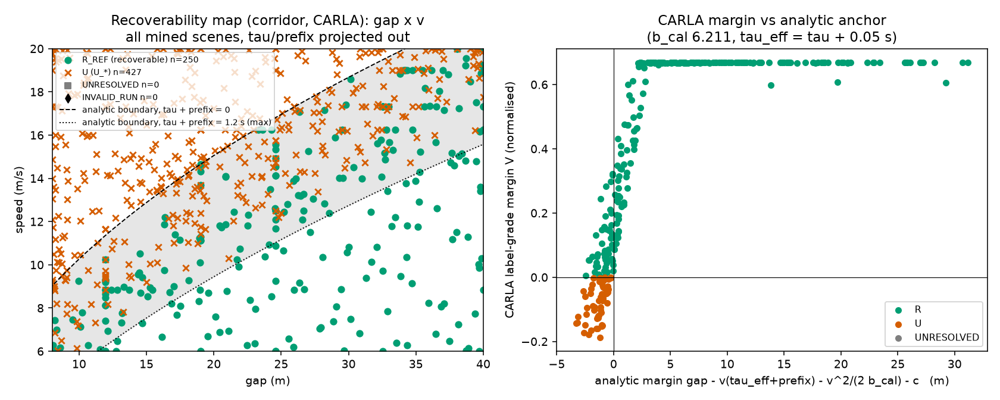
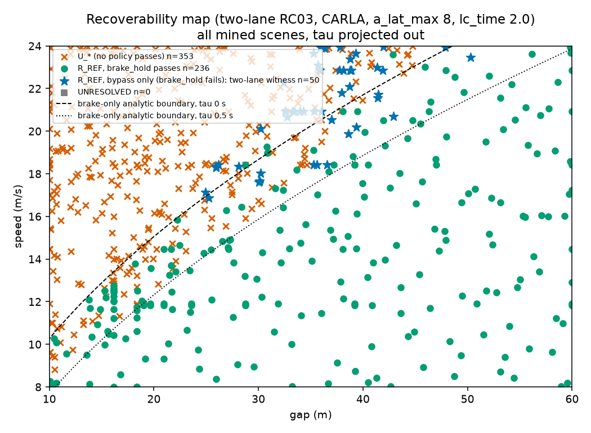
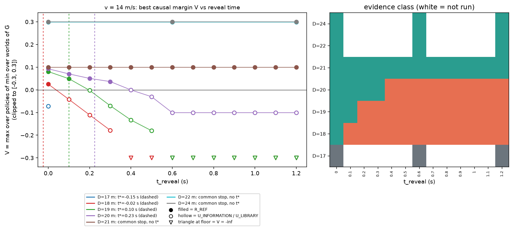

# CARLA physical-scenario results (final report)

Branch `carla-physical-scenarios`, CSC2626 recoverability project (Approach 1). Generated by `scripts/build_carla_report.py` from the committed result files under `mining/results/carla/` (tables are copied or computed from those files; prose is hand-written). Mock and CARLA results are kept apart throughout: CARLA files live under `mining/results/carla/`, mock files under `results/mock/`. Raw `*.jsonl` records are git-ignored (local only), so tables built from them cannot be re-verified from a clone; the committed `.md` files are the evidence.

Labels (`R_REF`, `U_LIBRARY`, `U_INFORMATION`, ...) come only from `contract.classify` on the executed policy x world margin matrix. Intentions never become labels. `U_LIBRARY` and `U_INFORMATION` are relative to the stated finite library and world set; CARLA never produces `U_MODEL`.

## 1. Runtime, versions, seeds, servers

```
{{RUNTIME_JSON}}
```

- Physics profile `{{PROFILE_ID}}` (Tesla Model 3, knob = max_brake_torque at fixed tire_friction 5.0), margin config `margin.DEFAULT_V2` (reserve c = 1.0 m, eps = 0.0, horizon 8 s); both ids are written into every record. Blueprints: {{BLUEPRINTS}}. World settings: {{SETTINGS}}.
- One CARLA server on port 2000 at a time (only one instance fits the 6 GB GPU), custom map `straight_2lane`, headless, no sensors.
- Seeds: mining runs use seeds 0 and 1; D5 uses seeds 0 and 1; scenario-level CARLA runs are deterministic functions of theta apart from the plant noise described in section 7.
- Server restarts: (a) after the hang during the Task 4 fix round (the controller restarted the single instance; selftest keep-test v0 shifted from 11.97 to 11.87 m/s afterwards, as recorded in `core.md` (Server sessions); the current `selftest.txt` brake check reads 9.07 m/s^2); the Task 2 bring-up predates it; (b) a crash before the Task 9 D5 run, again restarted as a single instance on port 2000, selftest PASS on the new session (`mining/results/carla/selftest.txt` is that rerun). RC12 and RC19 records are from the session before restart (a).

## 2. Acceptance checklist

PASS = criterion met as stated; WARN = met with a caveat listed in section 7; NOT EXECUTED = not done, with the reason.

| task | item | status | paths / note |
|---|---|---|---|
| 1 | physics profile, monotone brake map covers 5-9 m/s^2 | WARN | `calibration.md`, `physics_profile.json`; friction 5.0 non-physical, decel range 4.77..17.51 is a torque-knob abstraction |
| 2 | bring-up selftest | PASS | `selftest.txt` (8 checks) |
| 2 | determinism, same server repeats | WARN | `determinism.md` is exact on its two cases (max dx, dlat, dv all 0.0000), but same-theta repeats of mined scenes are not bit-identical: 23 of 109 D4 repeated scenes (about 21%) showed spread in some repeat (`mining/*/d4.md`), and RC13 scene (14, 20, 0.2) spread 0.028 (`negatives.md`) |
| 2 | determinism across two servers | NOT EXECUTED | only one server fits the 6 GB GPU; undetected cross-process nondeterminism possible |
| 2 | timing | PASS | `timing.md` |
| 3 | RC01, RC02, RC16, RC17 vs analytic anchors | WARN | `foundation.md`; residuals test the formula structure, not an independent prediction (b_cal and tau_eff come from the same trace) |
| 4 | RC03 braking fails / bypass passes | WARN | `core.md`; window only at v 18 and 22 under a_lat_max 8 (none at 8, 11, 14); v 18 window is one gap, margin 0.008 |
| 4 | RC07 premature hand-back | WARN | `core.md` (re-run on fixed plant); contrast only at rear_gap 100 (selected gap 34, rear_gap 100, rear_v 18) |
| 4 | RC12, RC19, RC20 | WARN | `core.md`; RC12 and RC19 from the pre-restart session |
| 5 | corridor and rc03 mining (sobol, straddle, bisect, cem, bo_lcb), matched pairs, D4 repeats | WARN | `mining/corridor`, `mining/rc03`, `mining/repeat_spread.md`; sigma superseded (section 7) |
| 5 | RC07 mining family | NOT EXECUTED | optional in Task 5, skipped |
| 5 | qd_fail and qd_boundary on CARLA | NOT EXECUTED | not run on CARLA (exist in `algos.REGISTRY`, mock only) |
| 5 | G sensitivity on CARLA | NOT EXECUTED | only the mock files `results/g_sensitivity*.md` exist; no CARLA G-sensitivity file was produced |
| 6 | RC05, RC06, RC08, RC15, RC18 | WARN | `compositional.md`; moving actors start 3.2-5.3% low (compositional.md); RC18 limits declared, a_comb mask |
| 6 | RC04 | WARN | no CARLA positive witness after 92 scanned scenes (reported, not forced) |
| 7 | RC10, RC11, RC14 and the reveal-time transition | WARN | `occlusion.md`, `occlusion_transition.png`; the transition is shown, but the 0.25 s cross-check tolerance cannot be verified as pre-declared (single commit) and the analytic t* lies before the measured bracket in 4 of 6 scenes (a one-sided conservative bound, +0.05..+0.22 s), so the cross-check is weaker than a match |
| 8 | RC09 (25-member class refuted), RC13 | WARN | `negatives.md`; two headline margins inside the observed repeat spread |
| 9 | D5 info-gap mining: mock | PASS | `results/mock/mining/infogap/infogap.md` |
| 9 | D5 info-gap mining: CARLA | WARN | `mining/results/carla/mining/infogap/infogap.md`: only 36 scenes; all 6 hits come from seed 1; 4 of 6 hits have V = -inf; one hit (V_hind 0.002) is inside the repeat spread; the search ranks on a graded search signal that favours collision severity (section 5) |
| 9 | E1 export + `validate_dataset.py`, mock and CARLA | WARN | section 6: validators pass (0 invalid on both), but `history` is null in 1336 of 1372 CARLA rows (only the 36 infogap rows have it), mock `physics_profile` is null by design, and pair rows are merged into the split group of both members' neighbourhoods (union-find) |
| 9 | Cosmos appearance variants | NOT EXECUTED | none exist; `parent_id` and `variant_kind` are null in every row |

## 3. Tables

### 3.1 Calibration and profile

{{CALIB}}

Selftest (`selftest.txt`):

```
{{SELFTEST}}
```

### 3.2 Determinism and timing

{{DETERMINISM}}

{{TIMING}}

The cross-server comparison was not run. Same-server repeats of the determinism cases are exact, but mined scenes repeated later show a small spread (section 7).

### 3.3 Anchors vs CARLA (residuals)

Copied from `foundation.md`.

{{ANCHORS}}

Other anchors: RC12 upper feasible prefix minus analytic T_p* = +0.016 s (`core.md`); RC19 anchor vs nuisance twin |dV| = 0 at v 8 and 12 (tolerance 0.05); Task 7 reveal-time thresholds sit +0.05 to +0.22 s after the analytic t* (`occlusion.md`, section 4).

### 3.4 G sensitivity

Mock only (`results/g_sensitivity.md`, `results/g_sensitivity_v2.md`, untracked local files). No CARLA G sensitivity was produced (NOT EXECUTED).

### 3.5 Per-family mining

CARLA, 2 seeds, 100 scenes per sobol/straddle/bisect run and 40 for cem/bo_lcb (mean +/- rough 95% CI over 2 seeds; the columns are defined in each `summary.md`).

**Corridor** (`mining/corridor/summary.md`)

{{CORR_TAB}}

**rc03** (`mining/rc03/summary.md`)

{{RC03_TAB}}

D4 (`mining/corridor/d4.md`, `mining/rc03/d4.md`): strict near-boundary sets of 16 (corridor) and 63 (rc03) scenes, each re-run 3 times in the same session; 0 of 32 and 0 of 77 repeated rows changed sign or label, but 9 of 32 and 14 of 77 had a nonzero spread, so repeats are not bit-identical (23 of 109 repeated scenes, about 21%, showed spread in some repeat).

**Re-flag at the max observed spread 0.028.** The numbers above use the Task 5 sigma 0.01666. `scripts/spread_reflag.py` recomputes them from the local records at both values (output `mining/results/carla/mining/sigma028.md`, copied below). At 0.028 the near-threshold sets grow (corridor 16 to 21 scenes, rc03 63 to 88) and the added scenes (5 and 20) were NOT repeated, so the D4 claim 'no repeated row changed label' holds only for the scenes that were repeated, and nothing is known about the others. The summary `near_boundary` count (abs(V_search) < 0.3) is a window about 10 times the spread and is insensitive to sigma. `label_vs_anchor_agree` (corridor) is 0.929 over all scene records; excluding scenes whose analytic margin is inside the noise band changes it to 0.932 at the old sigma and 0.938 at 0.028, so the agreement does not depend on those scenes.

{{SIGMA028}}

### 3.6 Evidence mix

Mining scenes (all algorithms, 2 seeds):

**Corridor**

{{CORR_MIX}}

**rc03**

{{RC03_MIX}}

Task 7 reveal sweep (`occlusion.md`, reveal-sweep scenes only, RC14 excluded): {{OCC_MIX}}. D5 mixes are in section 5.

### 3.7 Matched pairs (human-readable)

Each pair changes ONE factor and both members are re-labelled with the full R matrix (`verified` = unrecoverable side is `U_*` and recoverable side is `R_REF`). Full lists: `../mining/results/carla/mining/corridor/pairs.md` and `../mining/results/carla/mining/rc03/pairs.md`. Matched-pair counts in the exported dataset are in section 6. Mock pairs: `results/mock/mining/corridor/pairs_bisect_s*.jsonl` (local, not listed here).

{{PAIRS}}
On the corridor the CARLA flip sits about 1 m later than the analytic boundary on average (section 7).

## 4. Figures

- Recoverability maps (gap x v): `../mining/results/carla/mining/corridor/map_corridor_gap_v.png` and `../mining/results/carla/mining/rc03/map_rc03_gap_v.png` (rc03 is the two-lane family).




- Reveal-time transition (R_REF to U_INFORMATION as t_reveal grows):



- Feasible-delay sets: RC17 delay sweep (tick-quantised edge, analytic tau* inside the feasible-to-infeasible tick interval) is in `foundation.md`; the RC12 feasible-prefix set [0, 2.0] s (down-set True) is in `core.md`.

Task 7 evidence classes per scene and reveal time (from `occlusion.md`):

{{TRANSITIONS}}

Measured thresholds (bracket of last R_REF and first U_INFORMATION): v 14: D 18 (0.0, 0.1), D 19 (0.1, 0.2), D 20 (0.3, 0.4); D 21 and beyond have a common stop and stay R_REF. v 18: D 26 (0.2, 0.4), D 28 (0.4, 0.6), D 30 (0.8, 1.0).

## 5. D5 information-gap mining (RC10/RC11 family)

Info-gap scene = V_hind >= eps and V < eps. Family = RC10/RC11 with theta = (D, v, t_reveal), tau 0.25 s, b fixed at the calibrated 6.19, lc_time 2.0, a_lat_max 8. Objective: maximise V_hind - V subject to V_hind >= eps. The search algorithms (cem, straddle) see only the finite search signal from `R_norm`; labels, the objective and the found-scene lists come from the full record (`R_raw`, `contract.classify`). With V = -inf the label-grade gap is +inf; such scenes are listed apart from finite gaps. Mock first, then a small CARLA budget.

### 5.1 Mock (kinematic stand-in, not CARLA)

{{IG_MOCK}}

### 5.2 CARLA

{{IG_CARLA}}

{{D5_READING}}

## 6. Dataset export (E1) and validators

`python mining/export.py records --backend mock|carla` writes `scenes.jsonl` (schema `E1.1`) and `traces.npz`; `python mining/validate_dataset.py <dir>` checks them. Fields (all present in every row): `case_id, family_id, split_group, theta, history, policy_library_id, policy_library_version, world_set_id, R, V, V_hind, info_gap, evidence, margin_config, physics_profile, terminal {mode, boolean}, pair_id, pair_role, varied_factor, parent_id, variant_kind`, plus `backend, evidence_scope, seed, R_search, R_mask, best_policy, policy_library, world_set, sources`. R holds label-grade margins with `"-inf"` for terminal failure and null for unrun entries (with `R_mask`); non-applicable fields are null in every row (`pair_*` outside bisect pairs, `parent_id` and `variant_kind` always, `history` for records made without `keep_history`, `physics_profile` for the mock plant). `history` is `{policy, per_world, common_prefix_frames}` of delivered observations only (no world names or ids). `policy_library_version` and `world_set_id` are derived hashes of the policy descriptors and the world list/spec; split groups: pair members share the pair id, infogap scenes share a (D, v) group. Duplicate scenes from several algorithms are one row with all source files listed.

Dataset summary (computed from the exported files; `size` in bytes of scenes.jsonl + traces.npz):

```
{{DS}}
```

Split groups (`mining/splits.py`; the controller ruling): the natural group of a row is its family plus every non-distance theta factor for corridor and rc03 (all gap neighbours together), and the speed bin of width 1.0 m/s for infogap (every D and t_reveal at that speed together). A matched pair that varies a non-distance factor links the natural groups of its two members; linked groups are merged with union-find and every row of the merged component, pair rows and plain rows, gets the lexicographically smallest natural group id of the component. So both members of a pair, and every neighbour of either member, share one split. The first version assigned both members the unrecoverable member's group and left plain rows of the recoverable member's natural group in another split; that leak is closed. Group counts before the merge (natural) and after it are in the dataset summary below (`groups_natural`, `groups_after_merge`). `validate_dataset.py` checks across rows that all rows sharing a natural group share one assigned group, that every pair id has exactly one recoverable and one unrecoverable member in one group, that the assigned groups equal the union-find merge, and that each (backend, family) has one `policy_library_id` and one `policy_library_version`.

Pairs: pair members are keyed by (scene id, pair id, role) and never dropped by deduplication; a plain scene with the same theta as a pair member is the row that is dropped (its source file stays listed). An earlier export keyed rows by scene id alone and left 8 of 31 CARLA pair ids with a single role; the corrected CARLA export has 37 pair ids (the pairs files; pairs.md lists 31 distinct ones) with 74 rows, all complete. The mock export has 10 pair ids and 20 rows.

Library identity: `policy_library_id` is the family's library id from its plain records (corridor `corridor_v1`, rc03 `rc03_carla_lc2_full_alat8`, infogap `occ_lc2.0_al8lc2`; the mock corridor records carry none, so the mock id is the fallback `corridor_library`), also applied to pair rows. `policy_library_version` is a hash of the library definition (policy names, versions, terminal modes and non-theta parameters; the `@prefix` wrapper and theta-valued parameters such as prefix_s are not part of it), so it does not change with theta.

Locations: CARLA `mining/results/carla/dataset/`; mock `results/mock/dataset/` (repo root, per the global constraint that mock outputs live under `results/mock`; the brief had named `mining/results/<backend>/dataset`). Both are git-ignored: mock scenes.jsonl + traces.npz are about 12.8 MB and CARLA about 5.4 MB, over the roughly 5 MB limit for committing, so only the small md files are committed. The mock `physics_profile` is null by design: the kinematic stand-in has no CARLA physics profile, and the validator requires null there and a `pp_` id on every CARLA row. Validator output after the fix round: mock `454 records, 0 invalid`; CARLA `1372 records, 0 invalid`. Only the 36 CARLA infogap rows carry `history`; the 1336 corridor and rc03 rows predate history capture and have `history` null (consistently, not an empty list).

## 7. Known issues, caveats and surprises

{{HL_NOTE}}

**Repeatability.** {{RC13_SUMMARY}}

**Repeatability (spread).** The Task 5 D4 sigma (0.0167 margin units, from corridor and rc03 repeats) is superseded: the maximum observed CARLA repeat spread within one server session is **{{MAX_SPREAD}} margin units**, RC13 scene (v 14, D 20, t_reveal 0.2), witness world B ranging 0.0224 .. 0.0504 over four runs (`negatives.md`). It is about 1.7 times the Task 5 sigma. **Across server sessions the shift is larger: {{CROSS_SPREAD}}** (RC03 v 8, lc_time 1.2, gap 10.5: brake_steer_left went from +0.00989 to -0.18653 when the server was restarted and the scan re-run; no case label changed because other policies still carried those scenes). Cost if wrong: claims whose margin is below these spreads may not be reproducible. Headline claims checked against both figures (computed from the margins in the md files):

{{FLAGS}}

CARLA is not bit-reproducible: a minority of repeated scenes (23 of 109 repeated scenes (about 21%) showed spread in some repeat: 9 of 32 corridor and 14 of 77 rc03 rows) show a changed value within a session (sigma 0.0833 m in the corridor units); same-server determinism cases were exact, and cross-session repeats were not measured systematically beyond the RC03/RC20 re-run that gave the {{CROSS_SPREAD}} shift (the RC12 spread check of 10 scenes of one family is mostly saturated and proves nothing about cross-session spread).

**Plant.**
- Moving actors start 3.2-5.3% below their declared speed (warm-up drag, pinned each warm-up tick; measured first-tick speeds in `compositional.md`: RC05 5.3%, RC06 3.2%, RC15 3.2% low); measured t0 speeds are in the md files. Declared actor speeds are nominal upper bounds. RC07 was re-run on the fixed plant (it first ran with the rear actor about 15% slow); its scene moved to rear_gap 100 and the earlier (34, 80, 18) scene no longer holds.
- Within-session non-determinism, see above.
- `tire_friction` 5.0 is non-physical and the high-decel range is a torque-knob abstraction; CARLA's brake model locks the wheels near the end of a stop (decel spikes -28..-35 m/s^2 below about 4.3 m/s). The measured decel is about 5 m/s^2 at speed, so the constant-b formula is a distance-equivalent calibration (b_cal 6.211), not a physical constant.
- The actuation limits `a_lat_max = 8.0` and `a_comb_max = 8.0` m/s^2 are declared, not physical, bounds (recorded in every record's `geometry.spec`). Cost if wrong: the RC03/RC20 windows and the RC18 contrast depend on them.
- The `a_comb` evaluation ignores ticks unless the whole 0.25 s smoothing window is at or above 5 m/s (the stop-lock transient is a brake-model artefact). Cost if wrong: it also masks genuine friction-circle violations at low speed. The mask is applied to all policies and the unmasked peak is recorded.
- Onset delay resolution is one tick (0.05 s); the steer t90 is uninformative; decel targets outside the profile range are clipped silently; the b range 4..9 of the mock family extends below the profile floor 4.77, so CARLA mining fixes b at 6.19 (no braking-authority dimension on CARLA).

**Case-level findings.**
- RC04 has no CARLA positive witness (92 scanned scenes, none with the declared contrast); reported, not forced.
- RC03 shows its mechanism only at v 18 and 22 under a_lat_max 8; the brief's speeds 8, 11, 14 have no window. The v 18 window is a single gap with margin 0.008.
- RC07 contrast exists only at rear_gap 100.
- RC09: `U_LIBRARY` holds relative to the 25-member finite class `rc09_noescape_v1` and the one-world set only; the adjacent lane is blocked by a frozen queue so lane changes are in the class.
- RC13: the predictor is an illustrative inflated-envelope function outside the evidence pipeline; it uses axis-aligned box separation with clearance 0 on a nominal path, while the evidence uses oriented-box clearance with a 1 m reserve. Held to the same 1 m reserve the exact envelope disagrees with the evidence in 4 of 4 scenes. Part of the "false rejection" is a different safety convention, not only over-approximation.
- RC10/RC11: the hidden vehicle exists in CARLA (ground truth) and is withheld from the observation feed; there is no CARLA occluder. The map has two lanes, so the two escape corridors are the ego lane and the adjacent lane. The analytic t* is a one-sided conservative bound (+0.05..+0.22 s). The 0.25 s cross-check tolerance is declared in the script header; the single commit history cannot verify it was set before the run.
- Corridor matched pairs: the CARLA flip sits about 1 m later than the analytic boundary on average (pair midpoint analytic margin -0.97 m +/- 0.31, `corridor/summary.md`).

**Bookkeeping.**
- Raw `*.jsonl` records are git-ignored, so md tables are not re-verifiable from a clone (also the RC18 variant (a) rests on report text).
- `d4_repeats.jsonl` is untracked; "original values in the current session" in D4 is unverified (originals may predate a restart).
- Mixed server sessions: RC12 and RC19 from the earlier session; `Ctx.point` cache keys omit library id and `a_lat_max` (guarded by sweep-name tags); superseded files are excluded from validation by name only.
- The pre-fix core report (before the RC07 re-run) is no longer kept as a file; it is in git history at commit 21719eb (`mining/results/carla/core.md`).
- Minor open items: RC16 point-model column is constant True; `foundation.md` preamble still mentions an older bisection step; the RC18 refuted-by-comb column covers only the brake_steer policies; brake-onset smoothed a_long 8.79 vs decel target 6.19 is unexplained; Task 7 figure cosmetics; `negatives.md` prose "sigma is a conservative bound" is contradicted by the 0.028 spread (this report supersedes it).
- Task 1 (deferred minors): `measure_brake` keeps an invalid-start fit when its retries run out (`bringup.py` lines 50-52); the extra-tick guard in `plant_carla.py` (line 306) mismatches and the non-monotone branch has no test; the steer response is nonlinear; `response_delay_s` only means 'at most one tick'.
- Task 2 (deferred minors): the steer test is confounded by a 30-40% speed loss; tests are missing for the `hold_i` hand-off, `ScriptedActor` `ki` and the invalid-start None case; the scripted actor decel lags the nominal b under PI (a world-fidelity gap).
- Task 3: the fix report did not paste the pytest output (the implementer stated 71 passed).
- Task 5: the sigma loop has no explicit convergence assert; rc03 mining uses widened ranges (v up to 24, gap up to 60) and CARLA conventions (a_lat_max 8, lc_time 2.0), so the mock and CARLA rc03 tables are not comparable.
- Task 6: the first assertion of the harness `vmin` test is vacuous (an `or`).
- Task 7: the `history_check` threshold test only asserts the constant.
- Task 8: the marginal-scene rule has a cost: with sigma 0.0167 the RC13 headline was 4 scenes; at the observed spread 0.028 it is 2 (section 7, Repeatability); `negatives.md` wording is loose or stale ('within about 10%', 'single runs' in Plant caveats, 'sigma is a conservative bound'), and its Reading paragraph omits the E9 result (the exact envelope held to the 1 m reserve disagrees with the evidence in 4 of 4 scenes).
- Process notes: subagents ran on Sonnet 5.5 at medium effort; one controller-made doc fix (f644025) bypassed the implementer.
- D5 CARLA used a small budget by design (about 36 scenes); it is not a mining comparison between cem and straddle.

## 8. Open questions

For Andy and Victor:
- Reserve c: the 1.0 m reserve is a margin constant (`DEFAULT_V2`); should it scale with speed, and should it be the same for the lateral and longitudinal clearances? The RC13 mismatch shows a smaller predictor clearance flips decisions.
- Normalisation: margins are clearance / q_clear (5 m) and clipped for search; is that the intended scale for comparing G across families, given the 0.028 repeat spread (0.14 m)?
- eps: kept at 0 throughout. Given the spread, should eps carry a noise band, or should "near eps" scenes be reported as unresolved by rule?
- Library growth rule: finite libraries make `U_LIBRARY` provisional (RC20 shows a restricted library U_LIBRARY becoming R_REF when expanded). When is a library considered complete enough to state a negative?
- World set Omega: Omega here is the declared set per case (one world for RC09, two for RC10/RC11). What contents are required before an `info_gap` is meaningful beyond the declared worlds?

For Kent:
- Theta schema from logs: the exported theta fields are (gap, v, tau, prefix), (gap, v, tau), (D, v, t_reveal), plus fixed plant constants; which of these can be extracted from real logs (bumper gap, ego speed, reaction delay, reveal time)? The `history` field gives delivered observations with timestamps; is that the form the log extractor can produce?
